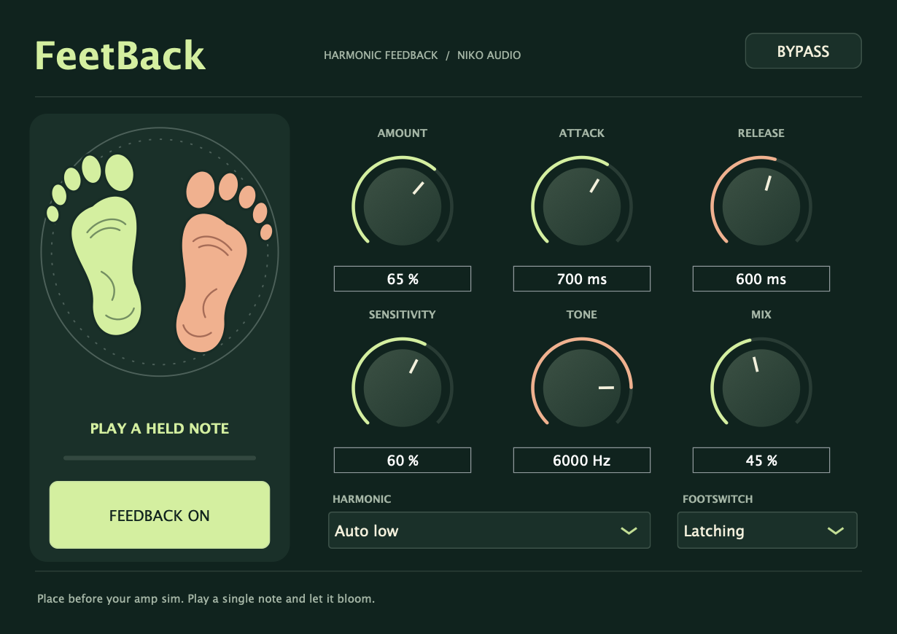

# FeetBack

A guitar feedback plugin for Logic Pro. Hold a note and let it grow into a singing harmonic. Pick how quickly it comes in, how long it hangs around, and how much you want to mix in. And yes, there are feet.

**[Download FeetBack 1.0.0 for macOS](https://github.com/nikoczernin/FeetBack/releases/download/v1.0.0/FeetBack-1.0.0-macOS-universal.zip)** · [All releases](https://github.com/nikoczernin/FeetBack/releases) · [Controls and manual](docs/MANUAL.md)



## Get it into Logic

Works on **Intel and Apple Silicon Macs** running **macOS 11 or later**, with a compatible version of Logic Pro. You can use it on mono or stereo tracks.

1. Download and unzip **`FeetBack-1.0.0-macOS-universal.zip`** using the link above.
2. Quit Logic Pro.
3. In Finder, choose **Go → Go to Folder…** (`Shift–Command–G`) and enter:
   ```text
   ~/Library/Audio/Plug-Ins/Components
   ```
   Create the `Components` folder if it’s missing.
4. Copy the whole **`FeetBack.component`** into that folder. If you’re updating, keep your old copy somewhere outside `Components` as a backup.
5. Reopen Logic and insert **Audio FX → Audio Units → Niko Audio → FeetBack**.

There’s also an **`Install.command`** helper if you’d rather let it handle the copying and backups. In Terminal, type `bash `, drag `Install.command` into the window, and press Return.

macOS may block the download because it’s locally signed and hasn’t been notarized by Apple. If that happens, or Logic can’t find it, the [install guide](docs/INSTALL.md) walks you through it.

## Give it a go

Place **FeetBack before your amp sim**: guitar DI → FeetBack → drive → amp/cab → delay/reverb. Choose **Auto low**, leave the feedback switch on, and hold a clean single note. Bends and vibrato follow your playing.

- Amount, Attack, Release, Sensitivity, Tone, and Mix.
- Eight harmonic choices, including two automatic modes.
- Latching or momentary feedback switch, plus separate bypass.
- Double-click a knob to reset it, type in values, or hover for a quick explanation. Settings save with your session, and you can automate them.
- Two vector feet. Mono and stereo support.

It works best with single notes. Chords and heavily distorted input can confuse the pitch detector. Your dry guitar stays undelayed; the feedback needs about 60–80 ms to find the note before it starts swelling in.

The [manual](docs/MANUAL.md) explains the controls, and the [test notes](docs/VALIDATION.md) cover what’s been checked.

## Build it yourself

Install Apple’s **Xcode Command Line Tools** (`xcode-select --install`) and **CMake 3.22+** ([CMake downloads](https://cmake.org/download/), or `brew install cmake` if you use Homebrew).

```sh
git clone https://github.com/nikoczernin/FeetBack.git
cd FeetBack
bash scripts/build.sh
bash scripts/install.sh
auval -v aufx FtBk Niko -strict
```

The script downloads **JUCE 9.0.5**, checks the download, builds for **Apple Silicon and Intel**, and runs the tests. Your plugin ends up in `dist/FeetBack.component`. If you already have JUCE 9.0.5, set `JUCE_DIR=/absolute/path/to/JUCE-9.0.5` before the build command. You can adjust the number of parallel build jobs with `CMAKE_BUILD_PARALLEL_LEVEL` (default 6).

You can also grab **source-with-JUCE.tar.gz** from the release page. It has the matching source and JUCE already packed together. Unpack it and run `bash scripts/build.sh`—you’ll still need Apple’s Command Line Tools and CMake.

To make your own release package, run `bash scripts/package-release.sh` after building and committing your changes. It puts the plugin, installer, source, JUCE, and download checksums in `dist/releases/`.

## Use it, tweak it, share it

This is open source under [AGPLv3](LICENSE.md). You’re welcome to use it, change it, and share it. If you pass the plugin on, including a version you’ve changed, make its source available under the same license too. That’s the short version; the linked license has the full terms.

Built with JUCE and a few other libraries. Their [credits and licenses are here](ThirdParty/README.md).

© 2026 Niko Czernin.
